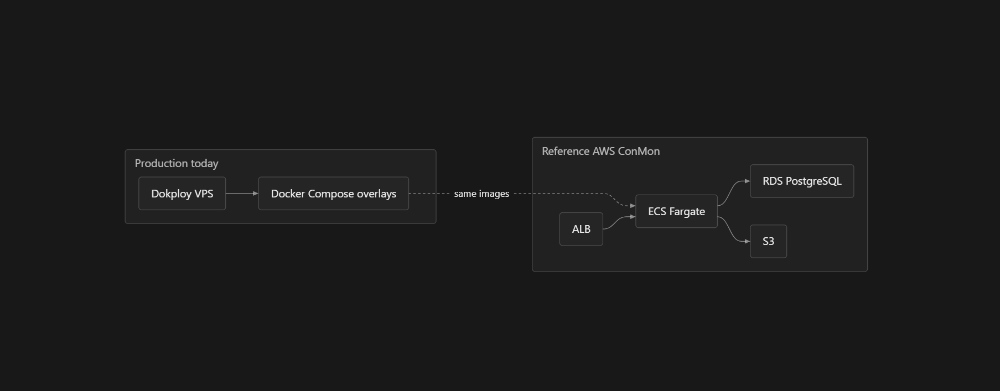
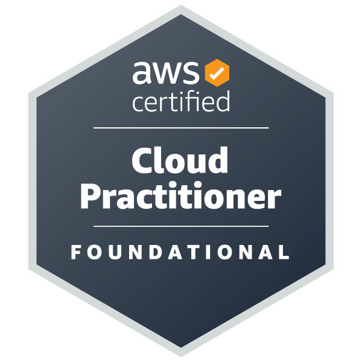
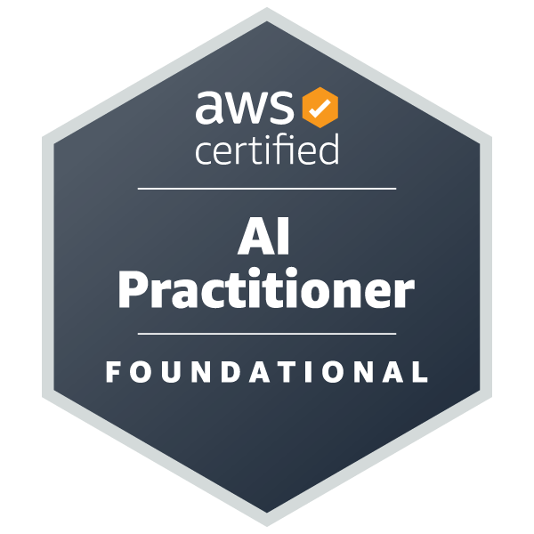
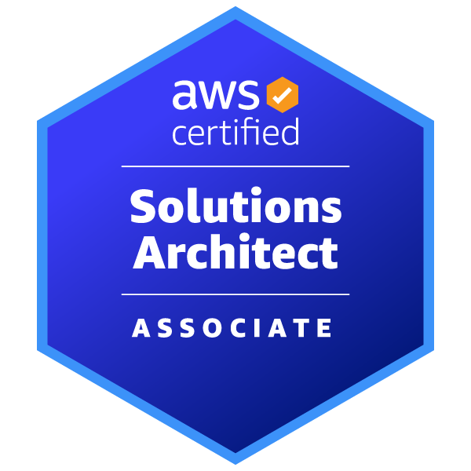
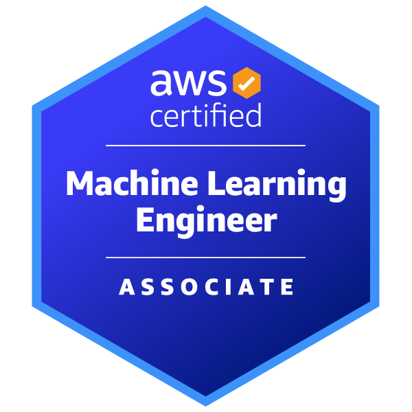
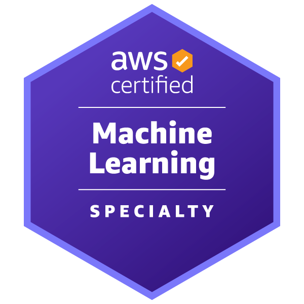

# Gerald T

### Senior Full Stack Engineer · AI Developer · AI Engineer

Building production-grade **AI systems**, **SaaS products**, and **full-stack platforms** — from Bun/Turborepo monorepos to mobile, desktop, and ML deployments.

---

## Quick Links

- [About](#about) · [Featured Work](#featured-work) · [Deployment & Multi-Target](#deployment--multi-target) · [AWS Certifications](#aws-certifications)
- [What I Build](#what-i-build) · [Tech Stack](#tech-stack) · [Monorepo Architecture](#monorepo-architecture) · [Currently](#currently) · [Connect](#connect)

---

## About

I'm a **senior full-stack engineer** and **AI developer** who ships **SaaS products** end to end — LLM-powered apps, agent orchestration, RAG systems, subscriptions, and the infrastructure behind them.

I work across **Bun/Turborepo monorepos**, **Next.js / React** web apps, **Flutter** and **React Native (Expo)** mobile, **Tauri** and **Electron** desktop apps, **Commander.js** CLIs, and **Python** backends (**FastAPI**, **Django**) for APIs and ML services.

**Focus areas:** LLMs · RAG & knowledge systems · AI agents & orchestration · system design · DevOps on AWS · full-stack product delivery.

**AWS 5× Certified** (Foundational → Specialty) — credentials are [verified on Credly](#aws-certifications) below.

Portfolio demos run on configured **VPS** infrastructure today. The same codebases use **MinIO** (S3-compatible object storage), containerized services, and **LocalStack** for local AWS emulation, so workloads can be ported to **S3**, **ECS/EKS**, **RDS**, and related AWS services without redesigning core flows. See **[Deployment & Multi-Target](#deployment--multi-target)**.

**Core strengths:** AI agents with runtime/request context · dynamic model switching · RAG & vector search · system design · payment gateways & webhooks · Dockerized ML endpoints · production MLOps · **Ragas** RAG evaluation · **Langfuse** observability for LLM traces.

---

## Featured Work

**Portfolio demonstrations** — sanitized, deployable builds that mirror real SaaS delivery (synthetic data, public-safe branding); same engineering standards as client products.

**Multi-target delivery:** **Dokploy** on VPS today (`docker-compose.dokploy.prod.yml` overlays, **Traefik**, **Turborepo remote cache**, optional **Sablier**); **AWS ECS Fargate** reference architecture in progress, starting with **[ConMon](https://github.com/geraldtt47/mining-equipment-tracker)**.

### AI Helpdesk — Ticket Support with RAG

`Public repo` · `SaaS` · `RAG` · `Mastra` · `Human-in-the-loop`

AI-assisted support for high-volume email: classify, summarize, **auto-resolve from a knowledge base**, and triage from an agent dashboard. When confidence is low, tickets **escalate to human agents** with context preserved.

- Offline **Ragas** evaluation for KB quality (`rag:eval`) · **Langfuse + Mastra** for runtime AI traces · **Mastra Studio** for local agent debugging
- **<10s** end-to-end AI agent response latency; **Ragas** KB scores (overall **8.18/10**, faithfulness **9.89/10**, **88.9%** pass rate across **18** evaluation queries)
- Modular DDA monorepo · pg-boss workers · Postmark inbound/outbound · Playwright E2E · Codecov

**Stack:** React 19 (Vite) · Express 5 · PostgreSQL · pgvector · Prisma 7 · Better Auth · Mastra · Langfuse · Bun + Turborepo · Expo (partial)

| **Resource**     | **Link**                                                                                                      |
| ---------------- | ------------------------------------------------------------------------------------------------------------- |
| **Landing page** | <a href="https://helpdesk.webminglers.co.za" target="_blank" rel="noopener noreferrer">View Landing Page</a>  |
| **Web app**      | <a href="https://app.helpdesk.webminglers.co.za" target="_blank" rel="noopener noreferrer">View Web App</a>   |
| **Repository**   | <a href="https://github.com/geraldtt47/ai-helpdesk" target="_blank" rel="noopener noreferrer">View Source</a> |

---

### ConMon — Mining Equipment Condition Monitoring

`Public repo` · `PWA` · `Offline-first` · `PowerSync` · `pgvector`

Offline-first **progressive web app** for mining flotation plant inspections. Field artisans capture condition scores, photos, and breakdown reports on rugged android tablets; managers review heat maps, analytics, and exports.

- **PowerSync** + local SQLite offline sync · **MinIO** presigned photo uploads (S3-compatible) · pg-boss background jobs
- **~50% faster** inspection-to-manager reporting cycle vs Excel/email collation (rugged-tablet **PWA**, **pg-boss** manager emails, heat-map analytics, **CSV/PDF** exports); **same-shift** manager visibility
- Optional AI embeddings via Mastra + pgvector · single-tenant org model (Better Auth)

**Stack:** React PWA · Express · PostgreSQL 16 · pgvector · PowerSync · MinIO · Mastra · Prisma · Bun + Turborepo

| **Resource**     | **Link**                                                                                                                   |
| ---------------- | -------------------------------------------------------------------------------------------------------------------------- |
| **Landing page** | <a href="https://conmon.webminglers.co.za" target="_blank" rel="noopener noreferrer">View Landing Page</a>                 |
| **PWA**          | <a href="https://app.conmon.webminglers.co.za" target="_blank" rel="noopener noreferrer">View PWA</a>                      |
| **Repository**   | <a href="https://github.com/geraldtt47/mining-equipment-tracker" target="_blank" rel="noopener noreferrer">View Source</a> |

---

### Contralysis — AI Contract Analysis

`Public repo` · `SaaS` · `Freemium` · `Multi-surface` · `Payments`

AI-powered **contract analysis** for teams reviewing PDF agreements: type detection, readiness scores, compliance gaps, risks, opportunities, clause breakdown, and negotiation points. **Free vs premium tiers** with tiered analysis depth.

- Mastra orchestration in `@repo/ai` (Gemini primary, OpenAI fallback) · **Paystack** subscriptions + Stripe legacy checkout
- Web, **Expo** mobile, and **Tauri** desktop surfaces · optional offline RAG eval (Ragas) · Playwright + Maestro quality gates

**Stack:** Next.js 16 · Express · MongoDB · Upstash Redis · Mastra · Passport (Google OAuth) · shadcn/ui · Bun + Turborepo

| **Resource**   | **Link**                                                                                                                |
| -------------- | ----------------------------------------------------------------------------------------------------------------------- |
| **Live demo**  | <a href="https://contralysis.webminglers.co.za" target="_blank" rel="noopener noreferrer">View Live Demo</a>            |
| **Repository** | <a href="https://github.com/geraldtt47/ai-contract-analysis/" target="_blank" rel="noopener noreferrer">View Source</a> |

---

### AI Calorie Tracker (Pegasus) — Mobile Nutrition & Wellness

`Public repo` · `Expo` · `Convex` · `DDD monorepo`

Mobile-first calorie and wellness companion: nutrition, hydration, and daily goals through a polished **Expo** app, **Next.js** marketing site, and **Convex** backend in a nested DDD layout.

- Thin `apps/*` shells · `@repo/domain-*` + feature packages · Maestro mobile E2E
- Local dev stack: Dockerized Convex, Mailpit, MinIO · `bun run verify` quality gate

**Stack:** Expo SDK 57 · Next.js 16 · Convex · React 19 · Uniwind · TanStack Query · Bun + Turborepo

| **Resource**     | **Link**                                                                                                             |
| ---------------- | -------------------------------------------------------------------------------------------------------------------- |
| **Landing page** | <a href="https://pegasus.webminglers.co.za" target="_blank" rel="noopener noreferrer">View Landing Page</a>          |
| **Web app**      | <a href="https://app.pegasus.webminglers.co.za" target="_blank" rel="noopener noreferrer">View Web App</a>           |
| **Repository**   | <a href="https://github.com/geraldtt47/ai-calorie-tracker" target="_blank" rel="noopener noreferrer">View Source</a> |
| **Google Play**  | _Coming soon_                                                                                                        |

<!-- For **architecture walkthroughs** or technical deep-dives, [message me on LinkedIn](https://www.linkedin.com/in/gerald-t-b851bb252/). -->

---

## Deployment & Multi-Target

Production portfolio apps ship as **Docker** images with **environment-driven configuration** (S3 endpoints, database URLs, feature flags)—the same artefacts target **VPS** or **AWS** without rewriting application code.

| Target                   | Status                                | Summary                                                                               |
| ------------------------ | ------------------------------------- | ------------------------------------------------------------------------------------- |
| **Dokploy (VPS)**        | Production (all live demos)           | Compose overlays (e.g. `docker-compose.dokploy.prod.yml`), Traefik, GitHub Actions CD |
| **AWS ECS Fargate**      | Reference architecture (ConMon-first) | ALB → Fargate services → **RDS PostgreSQL** + **S3** (replaces MinIO)                 |
| **AWS CDK (TypeScript)** | Local + optional deploy               | **LocalStack** in dev; extend ConMon LocalStack/CDK lessons                           |
| **Terraform**            | Learning / planned modules            | VPC, ECS, RDS, S3 parity with CDK reference—in progress                               |

**Canonical reference repo:** [**ConMon / mining-equipment-tracker**](https://github.com/geraldtt47/mining-equipment-tracker)—Postgres + Express API + offline **PWA** + **MinIO (S3-compatible)** + optional **PowerSync** maps cleanly to ECS/RDS/S3. **Helpdesk** follows the same Postgres pattern; **Contralysis** uses MongoDB/Redis; **Pegasus** uses **Convex** (AWS path documented separately).

<!-- Detailed IaC checklist and diagram reminders: private [skills-gap.md](./skills-gap.md) · workflow template: [templates/github/aws-iac-plan.yml](./templates/github/aws-iac-plan.yml) (copy to ConMon `.github/workflows/`). -->

  

---

## AWS Certifications

**5 verified AWS credentials** — cloud foundations, solutions architecture, and AI/ML from practitioner through specialty. All badges link to live verification.

  
  
  
  
  

| Certification                             | Level        | Relevance                                        |
| ----------------------------------------- | ------------ | ------------------------------------------------ |
| **Cloud Practitioner**                    | Foundational | Cloud literacy, security, billing                |
| **AI Practitioner**                       | Foundational | Generative AI, foundation models, responsible AI |
| **Solutions Architect – Associate**       | Associate    | Scalable, well-architected systems on AWS        |
| **Machine Learning Engineer – Associate** | Associate    | ML pipelines, deployment, MLOps on AWS           |
| **Machine Learning – Specialty**          | Specialty    | Deep learning, tuning, production ML workloads   |

[Verify all credentials on Credly →](https://www.credly.com/users/geraldt/badges/credly)

---

## What I Build

| Area                     | What I deliver                                                                                                                  |
| ------------------------ | ------------------------------------------------------------------------------------------------------------------------------- |
| **AI & agents**          | LLM apps, agent orchestration, runtime context, multi-model routing, RAG, embeddings, guardrails & evaluation (Ragas, Langfuse) |
| **SaaS**                 | Subscriptions, multi-tenant RBAC, admin settings, notifications, billing integrations                                           |
| **Full stack**           | Next.js / React, API design, Bun/Turborepo monorepos, TypeScript services, FastAPI & Django backends                            |
| **Mobile**               | Flutter, React Native (Expo), shared packages across web and mobile                                                             |
| **Desktop & CLI**        | Tauri, Electron desktop apps · Commander.js CLI tools                                                                           |
| **Payments**             | Paystack, PayFast, Yoco, Stripe — checkout flows and **webhook** handling                                                       |
| **Vector & data**        | pgvector, Convex, MongoDB, PostgreSQL, Redis, Prisma                                                                            |
| **ML delivery**          | Dockerized model APIs, MLflow, Hugging Face models, Kaggle datasets                                                             |
| **Architecture & cloud** | Multi-target deployment (VPS + AWS reference), IaC (**CDK**, **Terraform**), system design, CI/CD, observability                |

---

## Tech Stack

### AI, Agents & RAG

Mastra · Langfuse · OpenAI / Anthropic / Google APIs · RAG · pgvector · Convex · agent runtime & model switching · Ragas evaluation

### Full Stack, Monorepos & Python Backends

TypeScript · JavaScript · React · Next.js · Node.js · **FastAPI** · **Django** · GraphQL · Prisma · Bun · Turborepo monorepos · Better Auth

### Mobile, Desktop & CLI

Flutter · React Native (Expo) · **Tauri** · **Electron** · **Commander.js** CLI apps

### Data, Vectors & Storage

PostgreSQL · **pgvector** · **Convex** · MongoDB · MySQL · Redis · DynamoDB · Supabase · Elasticsearch · MinIO (S3-compatible)

### Payments & Integrations

Stripe · Paystack · PayFast · Yoco · REST webhooks · idempotent event handling · SaaS checkout flows

### ML / MLOps

Docker model serving · **MLflow** · **Hugging Face** · PyTorch · TensorFlow · **Kaggle** datasets · SageMaker & Bedrock (AWS)

### DevOps & Cloud

AWS (5× certified) · GCP · Azure · Kubernetes · **Terraform** · **AWS CDK** · GitHub Actions · Linux · Dokploy · Traefik · IaC: CDK + Terraform (ConMon reference) · observability (Grafana, Prometheus, Sentry, Langfuse)

### UI / UX

Figma · Tailwind CSS · shadcn/ui · Radix · design systems

---

## Monorepo Architecture

Featured products are **Bun + Turborepo monorepos** with shared workspace packages — auth, Zod schemas, AI prompts, payments, and UI — so web, API, mobile, and background workers stay in sync. Layouts follow **modular DDD/DDA** boundaries (domains, features, thin apps) with documented `ARCHITECTURE.md` entry points in each repo.

---

## Currently

- Operating **RAG-powered helpdesk** with Ragas offline eval, Langfuse traces, and human-in-the-loop escalation
- Shipping **ConMon** offline-first field inspections with PowerSync and S3-compatible media storage
- Extending **Contralysis** multi-surface contract analysis with Paystack billing and freemium tiers
- Preparing **Pegasus** Android release and deepening Convex-backed mobile domains
- Documenting **multi-target deployment** (Dokploy → **AWS ECS**); **Terraform** modules in progress (ConMon-first)
- Developing a **full-stack AI agent SaaS** — scheduled and recurring runs plus third-party connectivity via **Composio**
- Building **AI social content** for small businesses — a dedicated team of marketing agents
- Building **WhatsApp commerce agents** — bookings, in-chat payments, reminders, and support with human escalation
- Open to **Senior Full-Stack Developer, AI Engineer and Application Developer** permanent roles

---

## Connect

<!-- 

 -->

---

Senior Full-Stack AI Engineer · AI-First Builder · AWS 5× Certified · SaaS & Agent Systems

